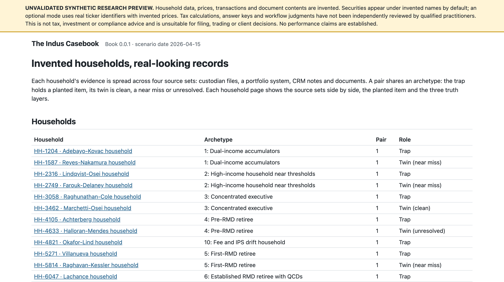
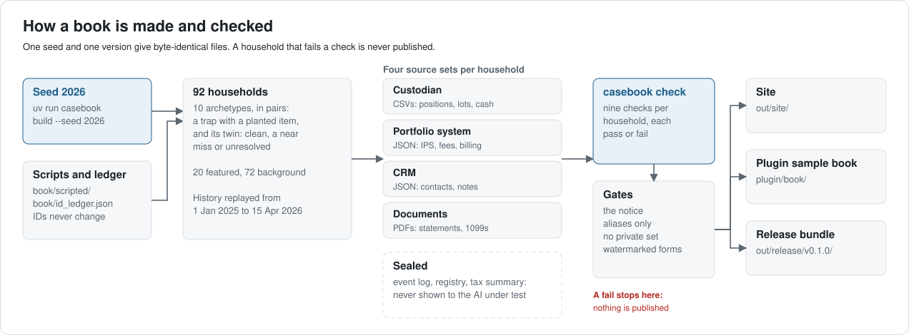
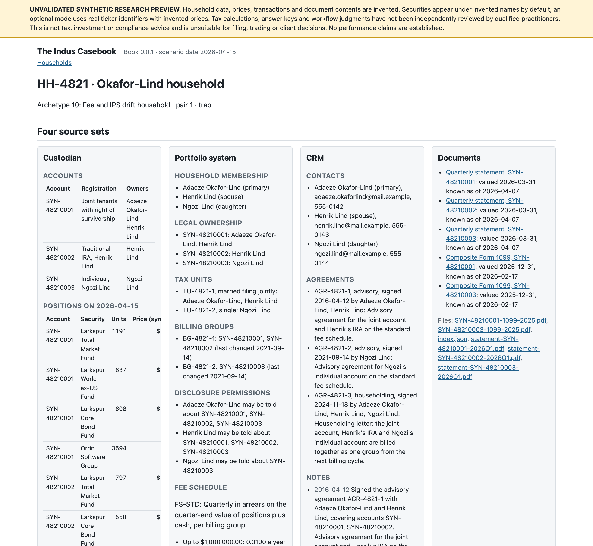
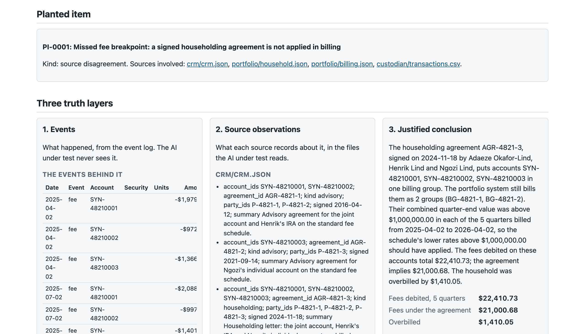
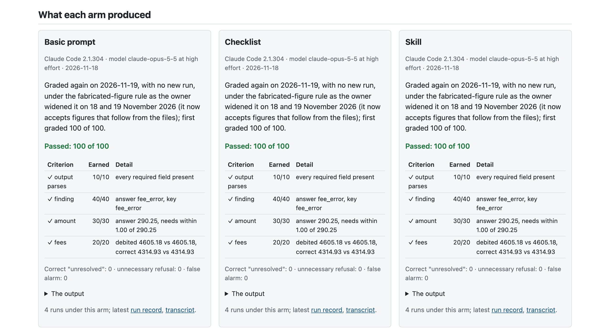
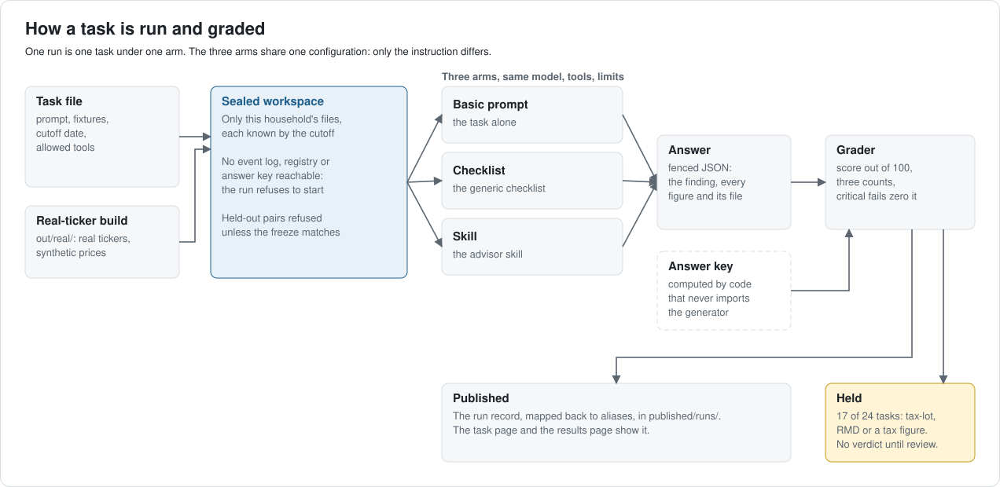
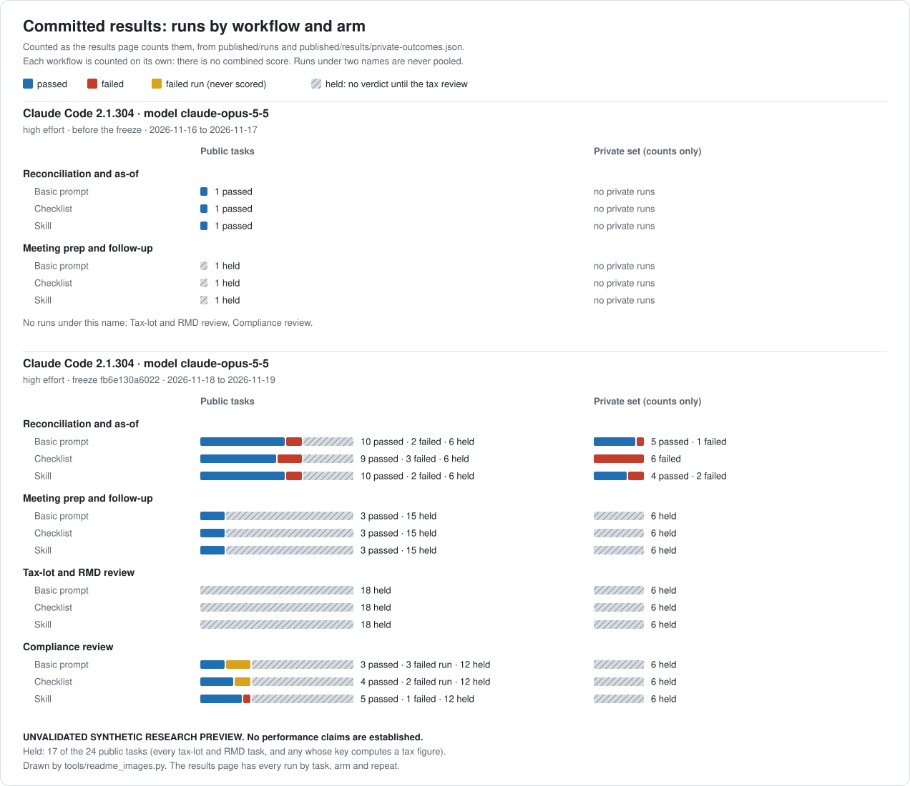
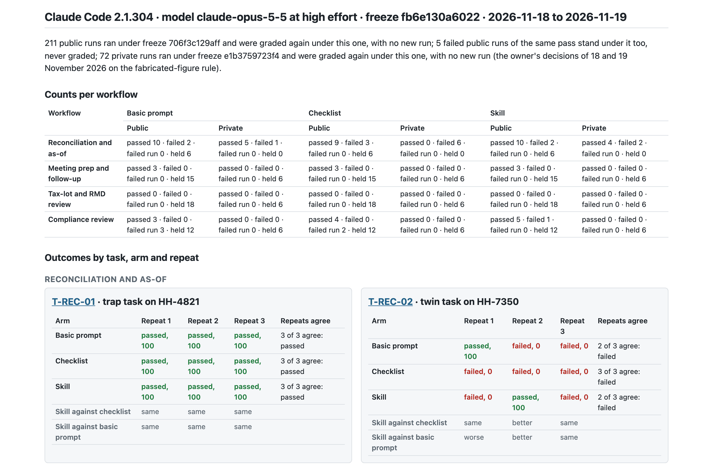
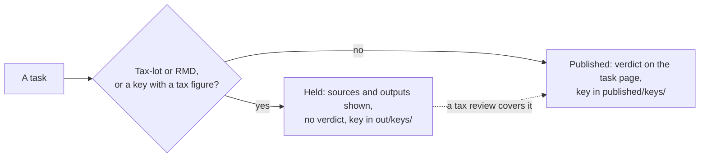

> **UNVALIDATED SYNTHETIC RESEARCH PREVIEW.** Household data, prices, transactions and document contents are invented. Securities appear under invented names by default; an optional mode uses real ticker identifiers with invented prices. Tax calculations, answer keys and workflow judgments have not been independently reviewed by qualified practitioners. This is not tax, investment or compliance advice and is unsuitable for filing, trading or client decisions. No performance claims are established.

# The Indus Casebook

The Indus Casebook is a public book of invented client households and graded advisor tasks. Each household's records are spread over four source sets, the way they are at a real practice, and they don't always agree. A trap household holds a planted item: a deliberate situation or disagreement between sources, with a registry entry and a justified conclusion. Its twin shares the archetype and most facts, and is clean, a near miss or unresolved.

It is for two people:

- **An independent US advisor** who wants to see, with nothing to install, whether an AI assistant handles a client's messy records safely. Open [the site](https://vaalmi.github.io/indus-casebook/) and read a household, a task and what each arm produced.
- **A builder** who wants to rebuild the same book from a seed and rerun the same test with one command.

This is the preview, v0.1.0: unvalidated, and no performance claims are established.



## Use it

You need [uv](https://docs.astral.sh/uv/) and `make`. Install everything once per clone: the Python packages, Playwright's Chromium and the git hook.

```bash
make setup
```

Build the book. The same seed and version give byte-identical files, into `out/book/0.0.1/`. The build refuses an ID the ledger contradicts, an identifier that could be real, a real ticker, or a difference between two sources with no registry entry.

```bash
uv run casebook build --seed 2026
```

Check it: nine checks on every household, one line each, pass or fail. It exits 1 on a fail.

```bash
uv run casebook check
```

Run a task. One run is one task under one arm (`basic`, `checklist` or `skill`) in a fresh, sealed workspace, and it writes a run record. It needs three things first:

- the signed-in `claude` CLI on your PATH; the run spends your own usage;
- `CASEBOOK_PRIVATE` set to a folder outside this repo, where the unmapped run record goes (it carries real tickers, so it never enters the repo);
- the real-ticker build the runs read, into `out/real/0.0.1/`:

```bash
uv run casebook build --real-tickers
```

Then:

```bash
CASEBOOK_PRIVATE=../indus-casebook-private uv run casebook run --task T-REC-01 --arm skill
```

It prints the run's ID with its state and score. It exits 2 if the run is refused before it starts (for example, a sealed file reachable from the workspace), and 1 if the run failed. The mapped record and transcript go to `published/runs/`, and the key to `published/keys/`: both are committed release files, so a tag rebuilds the task page. `uv run casebook canary`, with the same `CASEBOOK_PRIVATE`, checks first that a run can't read a sealed file outside its workspace.

Build the site into `out/site/`. It refuses a household that failed a check, and any page that fails a gate. Open `out/site/index.html` in a browser.

```bash
uv run casebook site
```

Write the release bundle into `out/release/v0.1.0/` (below, under "The release"). It needs both builds, the default one and the real-ticker one: its gate refuses any file that came from the real-ticker build, so it compares the two. It also needs the tag's IDs recorded in `published/releases.json`; the owner records them once, before tagging, by adding `--record --date YYYY-MM-DD`.

```bash
uv run casebook release --preview
```

Run every check the project has: lint, types, tests with the coverage floor, the import contracts, the float and licence checks, and the end-to-end tests. It calls no model and no network.

```bash
make check
```

## What's in the book



- **92 households** in the public book, in ten archetypes, each a pair: a trap and its twin. The book is 100 households; the other 8 are the private set's four pairs, kept outside this repo.
- **20 featured households**, one pair per archetype, each with its filled 2025 returns and a page on the site. The other **72 are background households**, drawn from the seed, with notes from templates and no model call.
- **Four source sets per household:** custodian CSVs (positions, transactions, tax lots, beneficiaries, settled and unsettled cash), portfolio-system JSON (IPS targets, restrictions, the fee schedule, billing groups), CRM JSON with notes, and document PDFs (statements, 1099s, and 1099-Rs, W-2s and SSA-1099s where they apply).
- **Two dates on every observation:** the valuation date the figure describes and the known-as-of date it became available. Every history starts from opening lots on 1 January 2025 and replays to the scenario date, 15 April 2026.
- **Invented names and prices.** 50 securities appear under aliases; every price is synthetic and says so.
- **A sealed layer** the AI under test never sees: the event log, the registry of planted items, and each household's tax summary.

| # | Archetype | # | Archetype |
| --- | --- | --- | --- |
| 1 | Dual-income accumulators | 6 | Established RMD retiree with QCDs |
| 2 | High-income household near thresholds | 7 | Inherited-IRA beneficiary |
| 3 | Concentrated executive | 8 | Recently widowed investor |
| 4 | Pre-RMD retiree | 9 | Cross-account tax-loss harvester |
| 5 | First-RMD retiree | 10 | Fee and IPS drift household (book 0.0.1 plants the fee item; the drift item comes later) |

A featured household's page shows its four source sets side by side. Here is HH-4821, the trap of archetype 10:



Further down the same page: its planted item and the three truth layers, ending in the justified conclusion with its figures.



## Tasks, workflows and arms

A **task** is one graded piece of advisor work. The public suite has 24, six in each of four **workflows**. Each workflow has two trap-and-twin task pairs and two book-level tasks.

| Workflow | Tasks |
| --- | --- |
| Reconciliation and as-of | T-REC-01 to T-REC-06 |
| Meeting prep and follow-up | T-MTG-01 to T-MTG-06 |
| Tax-lot and RMD review | T-TAX-01 to T-TAX-06 |
| Compliance review | T-CMP-01 to T-CMP-06 |

The **private set** is 8 more tasks, two per workflow, run on background pairs. It lives outside the public repo: the results page publishes its outcome counts only, never its prompts, outputs or run records. It is there to catch a tool that does well on the published tasks and poorly elsewhere.

Each task is attempted under three **arms**: the basic prompt, the generic checklist, and the skill under test. A task page shows what each arm produced, graded against the answer key. This is T-REC-01, on HH-4821:



## How a run is kept honest



Each rule is enforced by code that fails the run or the build, not by a line in a prompt.

- **Sealed answers.** The AI under test can never read the event log, the registry or an answer key. The runner refuses to start if any of them is reachable from the run workspace. `casebook canary` checks the CLI's own confinement.
- **No future evidence.** A task never shows a row or a document known after its cutoff. The fixture loader filters every one by its known-as-of date.
- **Equal arms.** The three arms share one runner configuration: model, tools, limits and records. Only the instruction differs. A run whose transcript doesn't show its instruction loaded fails, and is never scored.
- **Independent keys.** Answer keys are computed by code that never imports the generator. An import contract in `make check` fails if it does.
- **Freeze.** The hashes of every skill, the checklist and every grader are recorded before the held-out pairs run (`published/freeze.json`). The runner refuses held-out fixtures unless today's hashes match.
- **Synthetic households only.** The runner accepts only household IDs in the book's manifest.
- **Named results.** A result without its tool, version, model and date can't be published.

## Results

The committed runs, counted the way the results page counts them. Each workflow is counted on its own, per arm, public beside private. There is no combined score, and runs under a different tool, version, model or freeze are never pooled.



The results page has every run by task, arm and repeat, the skill against each other arm on the same task and repeat, and how often the repeats agree:



These are counts from one tool and one model on an unvalidated preview. They are not evidence that any arm is better.

## What is held, and why

No CPA or EA has reviewed the tax work yet. Until a review covers them, these stay held:

- **17 of the 24 public tasks:** every tax-lot and RMD task, and any other task whose key computes a tax figure. Their pages show the sources and what each arm produced, with no verdict and no failure marked. The results page counts their runs as held.
- **Their answer keys,** which stay in `out/keys/`. `published/keys/` holds only keys that may be published.
- **Each household's tax summary,** the tax answer sheet, kept off the site and out of every case packet.
- **Any combined score.**

A planted item's justified conclusion on a household page is not an answer key: the page shows it with its figures, under the notice, as the owner decided.



## The plugin

The four advisor skills install in Claude Code from this repo, with the **sample book**: the 20 featured households, under aliases. Its gate keeps a session that uses a skill on the sample book and refuses anything outside it, so there is no way to load your own files. [`plugin/README.md`](plugin/README.md) says how to install it, and what the gate allows.

## The release

`uv run casebook release --preview` writes one versioned bundle, `out/release/v0.1.0/`. The tag `v0.1.0` names the package version; it ships book version 0.0.1, the book the runs and the hand audit used. The bundle holds:

| Path | What it is |
| --- | --- |
| `README.md`, `LICENSE`, `LICENSE-DATA`, `NOTICE.txt` | this file, the licences and the notice |
| `release.json` | the tag, the package and book versions, the seed, the manifest's hash, a digest for every household and task ID, and a hash for every file |
| `book/` | the default book's files, without the sealed tax summaries |
| `site/` | the built site, with its case packets under `site/packets/` |
| `packets/` | one case packet per featured household |
| `runs/`, `keys/`, `results/` | the published run records, the keys that may be published, and the private set's outcome counts |
| `audit/` | the hand audit of 15 households: its log and `AUDIT.md` |
| `errata.json`, `freeze.json` | the errata log and the freeze record |
| `docs/images/` | this README's images |

Each folder whose files can't carry the notice themselves (the keys, the audit log, the images, the site) holds a `NOTICE.txt`.

A **case packet** is a zip of one featured household's source sets, with a separate answer sheet (`answer-sheet.json`): the planted item's justified conclusion with its figures, or the twin's explanation, and the keys of the household's tasks that aren't held. Tax answer sheets are absent until review. Every zip carries `NOTICE.txt` at its root.

The release fails if the bundle holds a tax or RMD answer key, a tax answer sheet, a verdict on a held task, a combined score, a household that failed a check, a real ticker or security name, any of the private set, a filled-form page without its watermark, a file without the notice, an unnamed result, or anything from `out/real/`. A changed household or task ID with no new version and errata entry fails it too.

The site is published at <https://vaalmi.github.io/indus-casebook/>, from a release tag, by `.github/workflows/pages.yml`.

## The images here

Every image in this README is drawn by one script from the real build: it builds the book from seed 2026 and the site from the committed runs into a temporary folder, screenshots four pages in Chromium, and draws the two diagrams and the results chart as SVG. Run it again after the runs or the site change:

```bash
uv run python tools/readme_images.py
```

## Licences

Copyright 2026 Vaalmika Platforms Inc.

Code: Apache-2.0 (`LICENSE`). Data: CC BY 4.0 (`LICENSE-DATA`).
